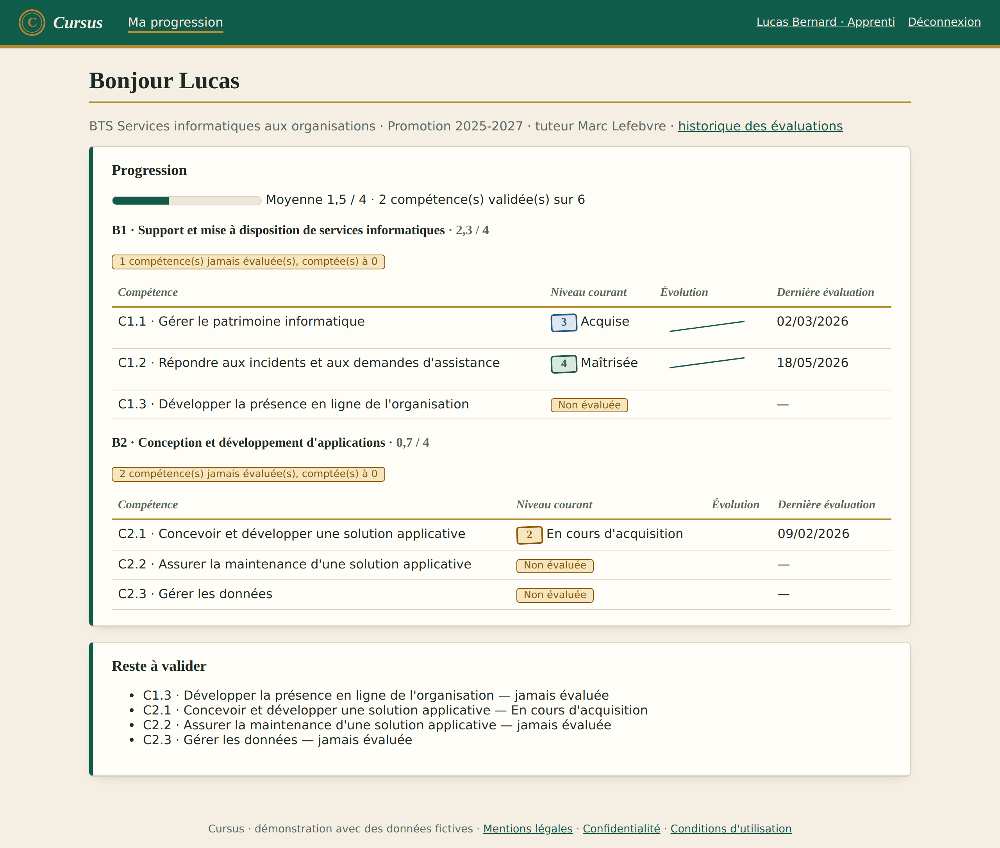
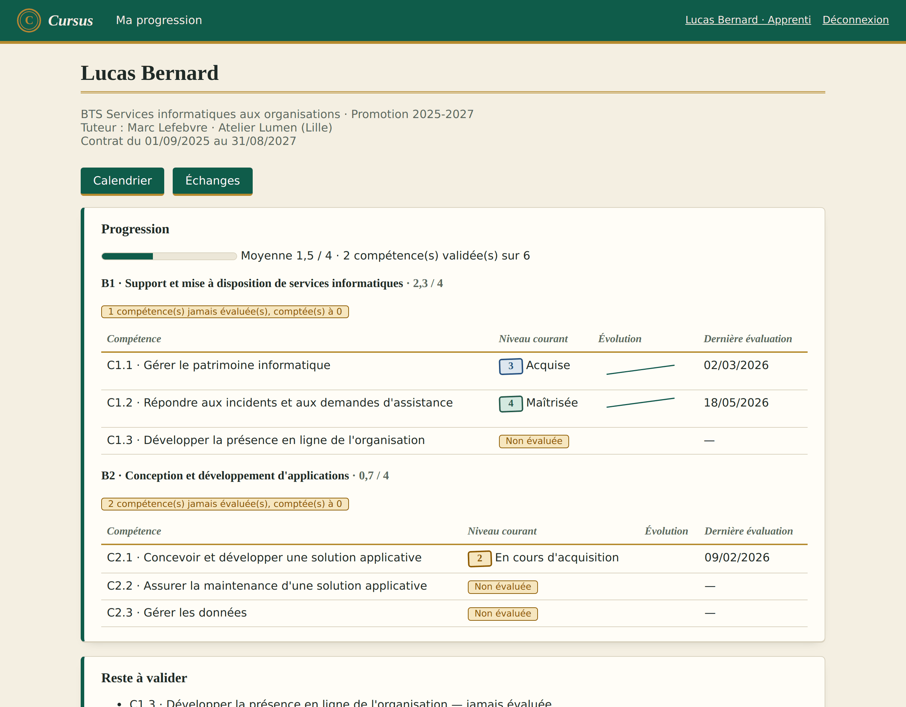
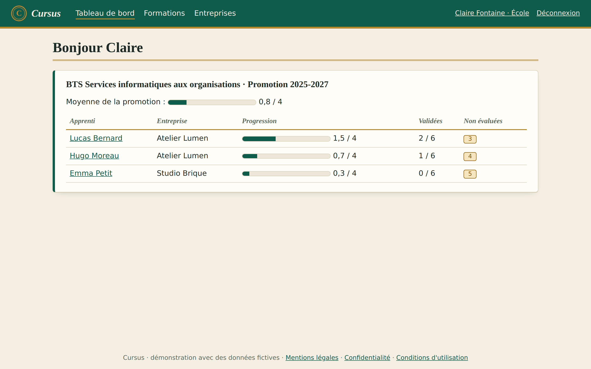
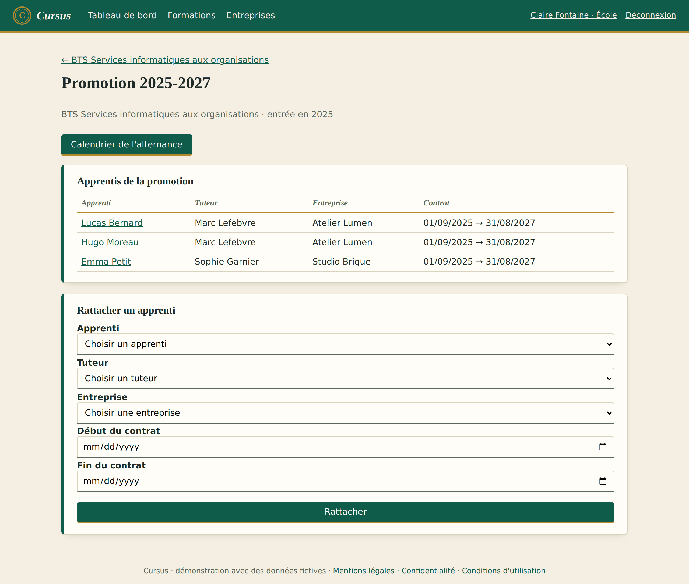
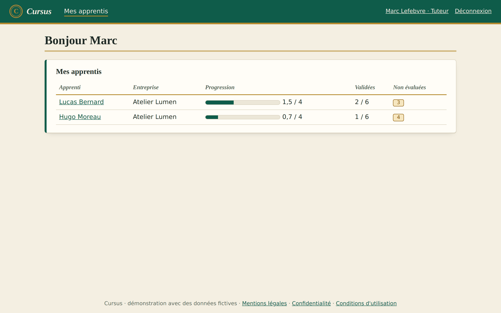
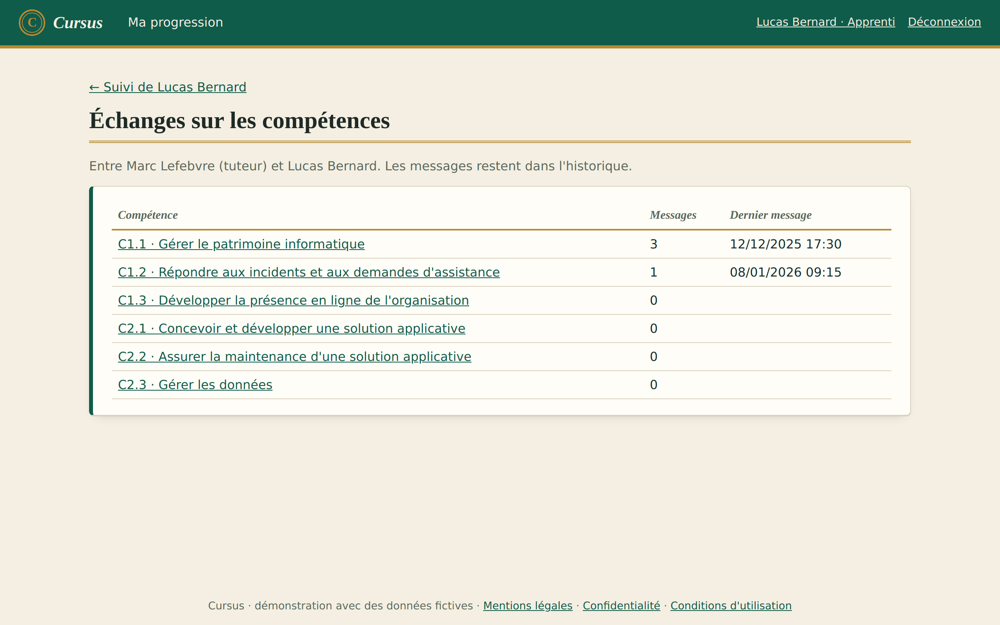

# Cursus

Suivi des compétences des apprentis, partagé entre l'école, l'entreprise d'accueil et l'apprenti.

Projet de fin d'études, écrit de zéro à partir d'un besoin fonctionnel : aucun code d'un autre dépôt n'est repris. Il sert de démonstration publique, avec des **données fictives uniquement**.

## Aperçu

Sur les comptes de démonstration (données fictives). Le visuel est celui d'un livret d'apprentissage : papier craie, encre verte, laiton des tampons.

| Progression de l'apprenti | Historique d'un contrat |
|---|---|
|  |  |

| Tableau de bord de l'école | Promotion et contrats |
|---|---|
|  |  |

| Les apprentis d'un tuteur | Échanges sur les compétences |
|---|---|
|  |  |

Les captures sont refaites par le workflow `Captures` (`tools/captures/captures.mjs`) : il démarre l'application, charge les fixtures et photographie chaque profil.

## Ce que fait la première version

| Profil | Ce qu'il fait |
|---|---|
| École | Crée les formations et leur référentiel (blocs, compétences), ouvre les promotions, enregistre les entreprises, rattache chaque apprenti à un tuteur, évalue en contexte « école », suit la progression de chaque apprenti et de la promotion, saisit le calendrier de l'alternance (périodes école et entreprise, évaluations prévues), lit les échanges |
| Tuteur en entreprise | Voit seulement les apprentis de ses contrats, évalue en contexte « entreprise », commente, échange avec l'apprenti sur chaque compétence |
| Apprenti | Consulte sa progression par bloc et par compétence, la courbe de chaque compétence, l'historique et ce qui reste à valider, son calendrier et ses évaluations à venir, échange avec son tuteur sur chaque compétence |

Une évaluation est une ligne datée, avec un niveau de 0 à 4. Rien n'est écrasé : le niveau courant d'une compétence est la dernière évaluation, et l'historique donne la courbe. La progression d'un bloc est la moyenne des niveaux courants, les compétences jamais évaluées comptant pour 0 et étant signalées. Une compétence est validée à partir du niveau 3.

## Stack

Symfony 8.1, PHP 8.5, PostgreSQL 16, FrankenPHP, Docker Compose. Qualité : PHPUnit, PHPStan, PHP-CS-Fixer, Infection, Gitleaks, CI GitHub Actions.

## Lancer le projet

```
docker compose up -d --wait
docker compose exec php bin/console doctrine:migrations:migrate --no-interaction
docker compose exec php bin/console doctrine:fixtures:load --no-interaction
```

L'application répond sur https://localhost:8443 (HTTP sur le port 8080). Les ports sont définis dans `.env` ; modifie-les s'ils sont déjà pris sur ta machine. Les courriers de développement arrivent dans Mailpit.

Les fixtures créent des comptes fictifs, tous avec le mot de passe `demo-cursus` :

| Profil | E-mail | Ce qu'on y voit |
|---|---|---|
| École | `claire.fontaine@cursus.test` | BTS SIO, trois apprentis |
| École | `paul.renard@cursus.test` | Titre Développeur web, une apprentie |
| Tuteur | `marc.lefebvre@cursus.test` | Lucas et Hugo |
| Tuteur | `sophie.garnier@cursus.test` | Emma et Nina, deux formations |
| Apprenti | `lucas.bernard@cursus.test` | Un historique sur plusieurs mois |

L'école et les tuteurs activent la double authentification à leur première connexion, en scannant un code QR avec une application TOTP (FreeOTP, Aegis…).

## Configuration

| Variable | Rôle |
|---|---|
| `TOTP_REQUIRED` | `1` : double authentification obligatoire pour l'école et les tuteurs ; `0` pour une démo à comptes partagés |
| `MAILER_DSN`, `MAILER_FROM` | Envoi des liens de mot de passe oublié (Mailpit en développement) |
| `LEGAL_PUBLISHER`, `LEGAL_HOST`, `LEGAL_CONTACT` | Éditeur, hébergeur et contact affichés dans les pages légales, à remplir dans `.env.local` avant une mise en ligne |

## Démo publique

Pour une démo ouverte à tous, mets `TOTP_REQUIRED=0` dans `.env.local` : sinon le premier visiteur activerait la double authentification sur un compte partagé. Les données se remettent à zéro avec la commande de fixtures ci-dessus, à planifier par exemple toutes les nuits :

```
0 4 * * * cd /chemin/vers/cursus && docker compose exec -T php bin/console doctrine:fixtures:load --no-interaction
```

## Organisation du code

| Dossier | Rôle |
|---|---|
| `src/Entity` | Modèle : `User`, `Formation`, `CompetenceBlock`, `Competence`, `Cohort`, `Company`, `Apprenticeship`, `Evaluation`, `CalendarPeriod`, `PlannedAssessment`, `CompetenceMessage`. Les règles qui doivent toujours tenir sont vérifiées dans les constructeurs |
| `src/Enum` | Profils, niveaux (0 à 4) et contextes d'évaluation |
| `src/Progress` | Calcul de la progression, sans accès à la base, testé seul |
| `src/Calendar` | Calendrier d'un contrat (période en cours, suivante, évaluations à venir), sans accès à la base |
| `src/Security/Voter` | `FORMATION_MANAGE`, `APPRENTICESHIP_VIEW`, `APPRENTICESHIP_EVALUATE`, `EXCHANGE_VIEW`, `EXCHANGE_POST` |
| `src/Form` et `src/Form/Data` | Formulaires branchés sur de petits objets de saisie typés ; l'entité n'est créée qu'à partir de valeurs validées |
| `src/Controller` | Une page par besoin : connexion, tableaux de bord, référentiel, promotions, suivi d'un contrat |
| `src/EventSubscriber` | Double authentification obligatoire, journal des connexions, en-têtes de sécurité |
| `src/Doctrine` | Nommage des colonnes sans le préfixe `a` des attributs |

Les attributs suivent la convention du projet (`a` pour un attribut, `p` pour un paramètre, `v` pour une variable locale, `r` pour la valeur retournée) ; `PrefixedNamingStrategy` garde des noms de colonnes lisibles (`aFirstName` devient `first_name`).

## Sécurité

Mots de passe en Argon2id, jeton CSRF sur tous les formulaires et sur la déconnexion, 5 essais de connexion par 15 minutes, même message pour un compte inconnu et un mauvais mot de passe. Mot de passe oublié par lien à usage unique de 30 minutes, session fermée après 30 minutes d'inactivité, export et suppression de son compte depuis « Mon compte ». Double authentification TOTP pour l'école et les tuteurs. Chaque accès à une donnée passe par un voter, testé pour chaque couple profil et donnée. Politique CSP stricte avec un nonce par requête, pas d'affichage dans un cadre. Les connexions et les évaluations sont journalisées avec des identifiants seulement. Gitleaks tourne en CI.

## Contrôles qualité

```
docker compose exec php bin/phpunit
docker compose exec php vendor/bin/phpstan analyse
docker compose exec php vendor/bin/php-cs-fixer fix --dry-run --diff
docker compose exec php vendor/bin/infection --threads=1
```

La première fois, et après chaque nouvelle migration ou fixture, prépare la base de test :

```
docker compose exec php bin/prepare-test-databases
```

Les tests tournent hors debug (quatre fois plus vite sous Docker pour Windows) ; `tests/bootstrap.php` vide le cache de test dès qu'un fichier de `config`, `src` ou `templates` a changé. Les fixtures sont chargées une seule fois ; chaque test fonctionnel tourne dans une transaction annulée à la fin (`dama/doctrine-test-bundle`). La CI rejoue ces contrôles à chaque push et chaque pull request.

### Aller plus vite en local

| Besoin | Commande |
|---|---|
| Règles métier seulement (quelques secondes) | `docker compose exec php bin/phpunit --testsuite unit` |
| Pages et accès | `docker compose exec php bin/phpunit --testsuite functional` |
| Un seul fichier ou un seul test | `docker compose exec php bin/phpunit --filter TrackingControllerTest` |
| Mutation sur un dossier | `docker compose exec php vendor/bin/infection --filter=src/Progress --threads=1` |
| Mutation sur les lignes modifiées | `docker compose exec php vendor/bin/infection --git-diff-lines --git-diff-base=origin/main --threads=1` |
| Mutation en parallèle | `docker compose exec php bin/prepare-test-databases 4`, puis `... infection --threads=4` |

Infection exige 98 % de mutants tués sur tout le code (indice actuel : 99 %, les mutants restants sont équivalents) et 85 % sur les lignes modifiées d'une pull request.

Infection lance une base par thread (`app_test1` à `app_test4`) grâce à `TEST_TOKEN` : prépare-les avant d'augmenter `--threads`.

## Avancement

Les lots 0 à 7 sont livrés dans la version 0.1.0, voir le [CHANGELOG](CHANGELOG.md) et la [feuille de route](ROADMAP.md). Hors première version : dépôt de fichiers, inscription en ligne, messagerie, export PDF du livret.

## Documentation

| Document | Contenu |
|---|---|
| [docs/decisions.md](docs/decisions.md) | Choix d'architecture et leurs raisons |
| [docs/securite.md](docs/securite.md) | Revue de menaces et liste des protections |
| [docs/mise-en-ligne.md](docs/mise-en-ligne.md) | Ce qui reste à faire avant une mise en ligne |
| [SECURITY.md](SECURITY.md) | Signaler une faille |

## Licence

[MIT](LICENSE)
